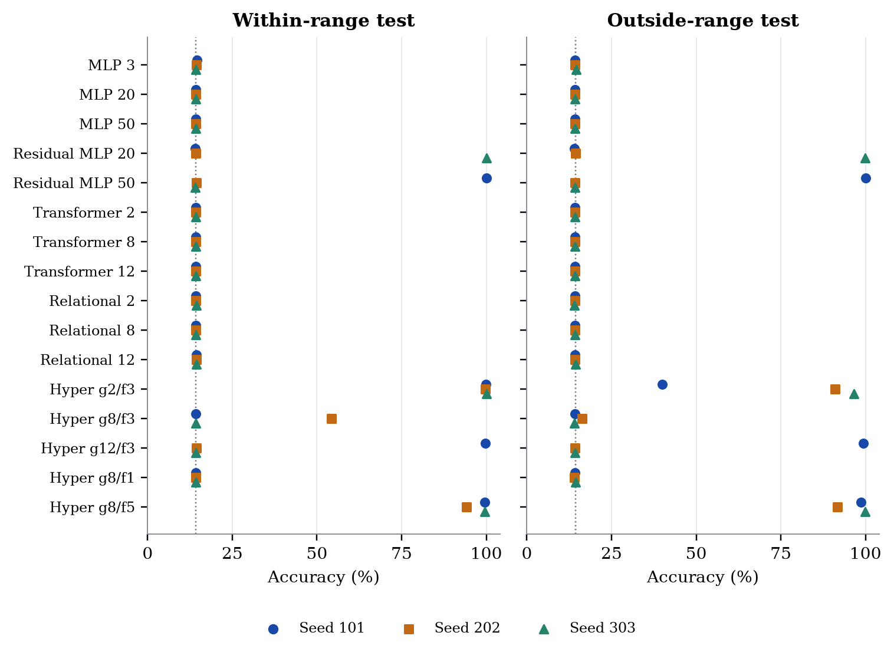
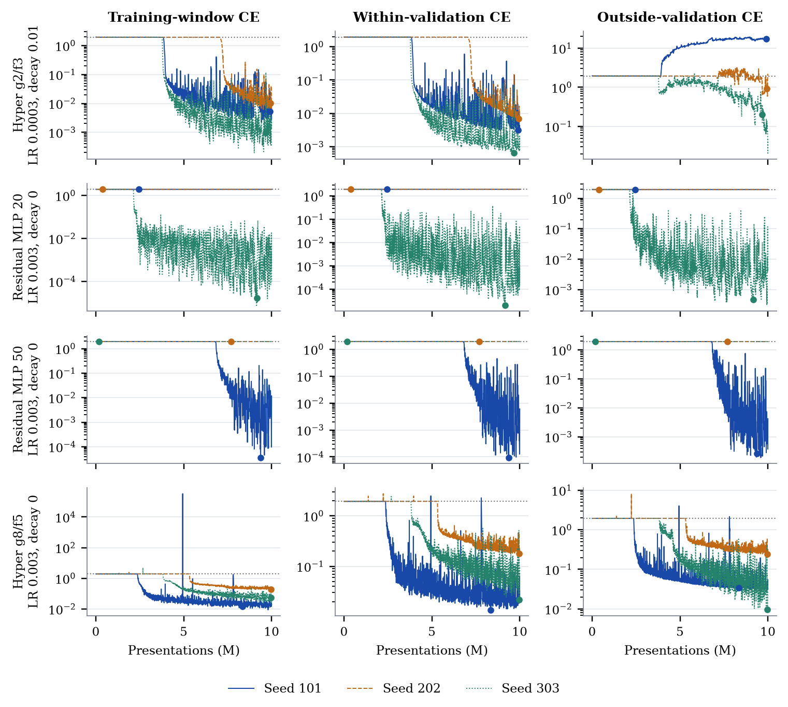

# Can a neural network learn the remainder?

**[Read the final report](report/report.pdf)** · [Editable LaTeX](report/report.tex) · [Protocol](PROTOCOL.md) · [Final data](results/million/final-2026-10-15/) · [Release assets](https://github.com/AntreasAntoniou/learning-modulo-seven/releases/tag/v1.0.0)

Take an integer, divide by seven, keep the remainder. A tiny program. Now give a neural network examples of that function and see whether it can discover something that keeps working when the numbers get larger.

We compare ordinary MLPs, residual MLPs, transformers, relational modules and input-conditioned hypernetworks. The report separates prediction on unseen values **within** the training range from prediction **outside** it, and keeps every optimisation seed visible.

## Completed experiments

| Experiment | Evidence | Status |
|---|---|---|
| Initial nonlinear-function screen | All 1,728 fits, including 576 modulo fits; three data amounts; recorded curves and selected seed scores | Complete |
| Observed-bit modulo diagnostic | All 96 fits and their curves | Complete; separately reported exploratory diagnostic |
| Million-example modulo experiment | All 576 fits, complete histories, frozen validation choices, 96 selected test results, predictions and portable selected weights | Complete |

The [v0.1.0 release](https://github.com/AntreasAntoniou/learning-modulo-seven/releases/tag/v0.1.0) preserves the original nine-page report and twelve-fit validation snapshot. The intermediate [560-fit draft data](results/million/draft-2026-10-15/) also remain unchanged. Version 1.0 reports the completed experiment, including its single frozen final test phase.

## What the final tests show

For the million-example experiment, within-validation loss selects the shallow binary hypernetwork `g2/f3`, with learning rate 0.0003 and weight decay 0.01. Across all three retained seeds it reaches **99.87% ± 0.15% within-range test accuracy**, but **75.79% ± 31.19% outside**. Its individual outside scores are **39.91%, 90.92% and 96.53%**. Fitting the within-range function consistently does not make extrapolation consistent.



The selected `g8/f5` recipe scores **97.71% ± 3.11% within** and **96.77% ± 4.42% outside**. That higher outside mean does not replace the winner chosen using within-validation loss. Four of the 48 selected binary models exceed 99% in both test domains: one seed each of residual MLP-20, residual MLP-50, `g12/f3` and `g8/f5`. No selected recipe does so in all three seeds. Scalar models remain near chance.



The earlier short-budget screen is a separate comparison. With 65,536 training examples, `g2/f3` reaches 94.56% ± 2.12% within and 11.94% ± 2.39% outside. Smaller-data fits stay near chance. The million-example follow-up changes domain, bit width, regularisation and exposure as well as data amount, so it is not a causal fourth point on that data-size curve.

Every ± is the **sample standard deviation over three optimisation seeds on one fixed dataset**, not a confidence interval. Successful individual fits establish finite-domain possibilities; they do not identify a modular algorithm or prove dependable extrapolation.

## Million-example protocol

- One million unique training integers; ten shuffled passes; scalar and 22-bit inputs.
- Sixteen architectures × two encodings × two learning rates × three weight decays × three seeds = 576 fits.
- AdamW, constant learning rate 0.0003 or 0.003, decay 0/0.01/0.1, no dropout, norm clipping 1, float32 with TF32 disabled.
- Batch 128 with an eight-example batch at every exact 5,000-example validation boundary; 10M presentations and 80,000 updates per fit.
- Within-validation loss selects checkpoints. Mean best within-validation loss across all three seeds selects each architecture/encoding's LR and decay. Outside validation is diagnostic.
- All 576 fits and their full histories were verified before selection was frozen. All 96 retained models were then evaluated once on two held-out sets of 65,536 integers each. Test scores never reselect models.

## Reproduce and inspect

Python 3.12+ is required. GPU runs used Python 3.13.13, PyTorch 2.8.0+cu128 and NumPy 2.3.2. Install a PyTorch build appropriate to your hardware.

```bash
python -m venv .venv
source .venv/bin/activate
pip install -r requirements.txt

python analysis/verify_results.py
python analysis/verify_million_final.py
python -m pytest -q experiments/million
python analysis/make_figures.py
bash report/build.sh
```

The 35 [scientific release archives](results/million/final-2026-10-15/release-assets.json) contain all 46,080,000 training batches and 1,152,000 validation records, the exact five data splits, all 96 prediction files and all 96 portable selected models. After downloading them into one directory:

```bash
python analysis/verify_million_final.py --assets /path/to/downloaded/assets
```

This checks every archive/member hash, recomputes every training window and rescores all 12,582,912 saved prediction rows. It does not train or run another final test. See the [data guide](results/million/final-2026-10-15/README.md) for fields, tensor loading and the distinction between attempt-local elapsed time and training exposure.

For a **new independent reproduction**:

```bash
python experiments/million/run.py prepare
python experiments/million/run.py list
python experiments/million/run.py train --case-id bits-hyper_g2_f3-wd0-lr0-s101 --device cuda
# Repeat training for every case. This requires substantial compute.
python experiments/million/run.py test --device cuda
```

`test` refuses incomplete grids and creates a one-time fence before reading test values. The scientific modules are byte-identical to frozen run source; `common.py` is a local storage adapter and `run.py` is a local entry point. [Source hashes](provenance/source-origins.json) document this boundary.

## Verification and limits

Saved accuracies match exactly; independent float64 cross-entropy recomputation agrees within 1e-6 absolute/relative tolerance. A separate CPU replay of 196,608 sampled rows changed no predicted class. It did exceed raw-logit tolerance in 14/192 model/domain comparisons and probability tolerance in 2/192; the largest probability difference was 0.000399567. Those failed comparisons are retained in the [audit](results/million/final-2026-10-15/prediction-audit.json). This establishes sampled class agreement, not numerical identity across devices and PyTorch versions.

The [claim ledger](claim-ledger.json) connects report claims to hashed evidence; [verification records](provenance/verification.json) describe the checks. Every page was rendered and visually inspected. The review is by the preparing agent, not independent scientific review, and Antreas has not approved the revised prose.

The million-example experiment used 29.08361 allocated GPU-hours, including setup, failures, recovery and final testing. All reservations were settled once, owned workloads and temporary access removed, and autoscaler cleanup verified. Billing and node startup/idle overhead were not measured.

The research question, architecture choices and follow-up direction are Antreas Antoniou's. Protocol development, implementation, analysis and writing were assisted by Codex under his direction. The official NeurIPS template is used in preprint mode; this is an independent research report, not a NeurIPS submission or acceptance. See [third-party attribution](THIRD_PARTY.md).
