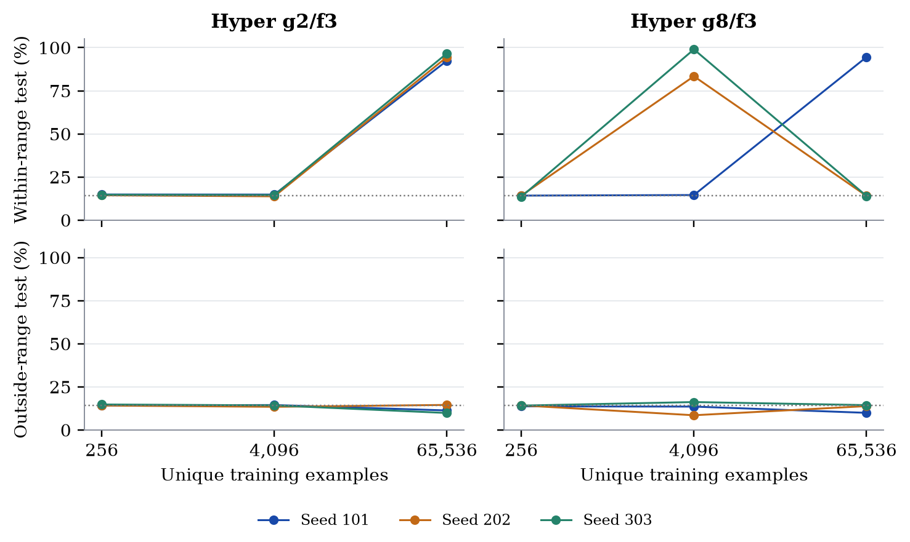
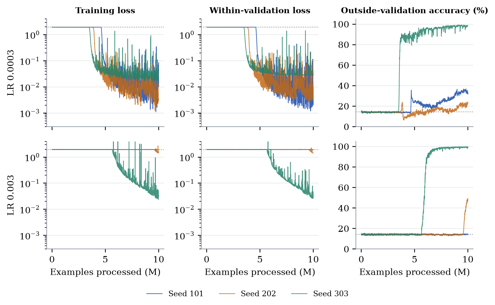

# Can a neural network learn the remainder?

**[Read the nine-page report](report/report.pdf)** · [Editable LaTeX](report/report.tex) · [Protocol](PROTOCOL.md) · [Measurements](results/)

Take an integer, divide by seven, keep the remainder. A tiny program. Now give a neural network examples of that function and see whether it can discover something that keeps working when the numbers get larger.

That is the question here. We compare ordinary MLPs, residual MLPs, transformers, relational modules and input-conditioned hypernetworks. We vary the amount of data and test unseen numbers both **within** and **outside** the training range. The report explains the mechanisms and keeps the awkward seeds visible.

## What is complete, and what is still running?

| Experiment | Public evidence | Status |
|---|---|---|
| Initial nonlinear-function screen | All 1,728 fits, including 576 modulo fits; three data amounts; all learning curves and selected per-seed scores | Complete |
| Observed-bit modulo diagnostic | All 96 fits and their curves; every training bit varies | Complete, separately reported exploratory diagnostic |
| One-million-example modulo sweep | Frozen snapshot of the first **12 completed fits**, their 24,000 validation observations and 960,000 batch records, collected **14 October 2026, 13:06 UTC** | **Partial: 12 of 576 fits in this snapshot; no final selection or test evaluation** |

The live sweep continues independently of this dated snapshot. The report and public data will be updated after all fits finish and the validation-only selection is frozen. A GitHub release preserves this first version.

## What we know so far

With 65,536 training examples, the shallow binary hypernetwork `g2/f3` reaches **94.56% ± 2.12%** within-range test accuracy, but **11.94% ± 2.39%** outside. Its smaller-data fits stay near chance. A deeper generator sometimes learns with 4,096 examples, but its seeds are much less consistent. Scalar input stays near chance throughout the initial screen.



The million-example follow-up is a longer experiment on a wider domain. In its first three completed zero-decay fits at learning rate 0.0003, within-range validation exceeds 99% for every seed, while outside-validation accuracy at those selected checkpoints is 35.16%, 19.01% and 98.23%. Those are **validation observations from one architecture**, not final test results or a winner across the grid.



Every ± above is the **sample standard deviation across three optimisation seeds**, not a confidence interval. The dataset is fixed. Equal training steps, equal passes and equal learned-parameter counts are different comparisons; the report spells out what each experiment holds fixed.

## Training recipe for the million-example sweep

- 1,000,000 unique integers; ten shuffled passes; scalar and 22-bit inputs.
- All 16 architecture variants, learning rates 0.0003 and 0.003, weight decays 0 / 0.01 / 0.1, seeds 101 / 202 / 303: **576 fits**.
- AdamW, β=(0.9, 0.999), ε=1e−8, constant learning rate, dropout 0, gradient-norm clipping 1, float32 and TF32 disabled. All learned parameters receive the chosen decay.
- Batch 128, with an eight-example final batch at each 5,000-example boundary. Every batch is logged; validation runs exactly every 5,000 examples.
- Within-validation cross-entropy selects checkpoints, with accuracy as a tie-break. Mean best within-validation loss across all three seeds selects the learning rate and decay for each architecture/encoding. Outside validation is diagnostic.
- **All 576 fits must finish before selection is frozen and the 96 retained models enter one final test phase.** Both test domains stay separate from the training worker.

## Reproduce and inspect

Python 3.12+ is required. GPU runs used Python 3.13.13, PyTorch 2.8.0+cu128 and NumPy 2.3.2. Install a PyTorch build appropriate to your hardware. CPU and GPU results can differ numerically.

```bash
python -m venv .venv
source .venv/bin/activate
pip install -r requirements.txt

# Recompute reported selections, means and standard deviations from released data.
python analysis/verify_results.py

# Verify the sample cadence, all architecture paths, selection and exact CPU resume.
python -m pytest -q experiments/million

# Rebuild all figures and numeric tables.
python analysis/make_figures.py

# Build the report with an installed TeX Live / MacTeX distribution.
bash report/build.sh
```

For a **new independent reproduction** of the million-example protocol:

```bash
python experiments/million/run.py prepare
python experiments/million/run.py list
python experiments/million/run.py train --case-id bits-hyper_g2_f3-wd0-lr0-s101 --device cuda
# Repeat train for all case IDs. This is substantial compute.
python experiments/million/run.py test --device cuda
```

`test` refuses incomplete grids. It uses a create-once local fence before reading test values. The public scientific modules are byte-identical to their frozen run source; `common.py` is a local-only storage adapter and `run.py` a new local entry point. [Source hashes](provenance/source-origins.json) document this boundary. The cloud deployment system is not required to reproduce the experiment.

The short screen can be reproduced one fit at a time:

```bash
python experiments/screen/suite.py --case-index 0 --output runs/screen --device cuda
python experiments/observed_bits/suite.py --config experiments/observed_bits/modulo-observed-bits.json --case-index 0 --output runs/observed-bits --device cuda
```

## Files and interpretation

`all-fits.jsonl.gz` contains every fit, including both learning rates and failed-to-learn seeds. `selected-fits.csv` contains the within-validation-selected learning rate for each seed; `summary.csv` aggregates those seeds. The initial screen uses `val`/`test` for the within domain and `ood_val`/`ood` for the outside domain. The million-example files use explicit `val_within`/`val_outside` names. Loss is cross-entropy for modulo; regression scores also appear in the wider screen's files.

The first release contains metrics, full recorded curves, source, figures and report. Archived model checkpoints and per-example prediction payloads are not included; their hashes are retained where available. No claim is made that the released metrics alone independently reproduce every prediction. [Verification scope](provenance/verification.json) distinguishes direct public checks from the completed private artifact audit.

The question, architecture choices and follow-up direction are Antreas Antoniou's. Protocol development, implementation, analysis and writing were assisted by Codex under his direction. The report uses the official NeurIPS preprint template; it is an independent working report, not a NeurIPS submission or acceptance. See [third-party attribution](THIRD_PARTY.md).
